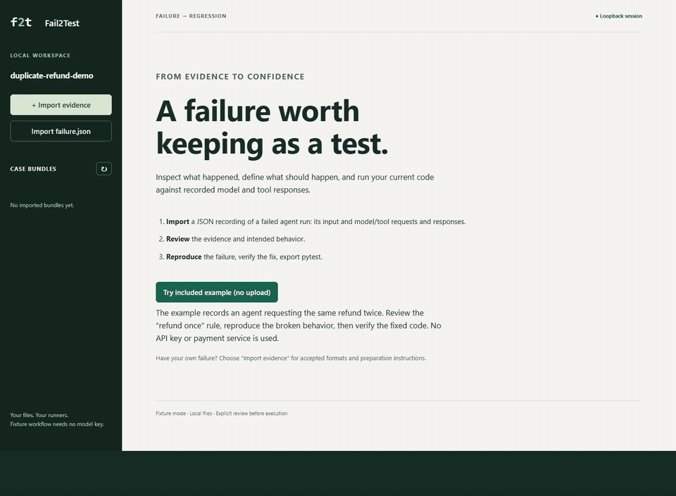

# Fail2Test launch kit

Prepared 2 November 2026 for owner review. **Nothing in this kit has been posted, submitted,
uploaded to a service or sent to another person.** These are AI-assisted drafts and a real
synthetic-workflow recording; venue-specific rules determine where text may be used.

## Review these first

- [30-day distribution and adoption plan](traction-plan.md).
- [Project-owned announcement and tutorial draft](announcement-drafts.md).
- [Demo, claims and reproduction notes](demo.md).
- [Primary-source channel research](../development/distribution-research.md).
- [Empty weekly scorecard](traction-scorecard.csv); actual owner-visible traffic snapshots
  stay in ignored local artifacts, outside this public-ready kit.

## Prepared assets

- [Captioned MP4](assets/fail2test-demo.mp4), approximately 28 seconds, 1440×1056.
- [Animated GIF](assets/fail2test-demo.gif), approximately 1.5 MB, for the README.
- [Caption text](assets/demo-captions.vtt) and [static poster](assets/demo-poster.png).
- [Project social-preview PNG](assets/social-preview.png), 1280×640 and under 1 MB.
  The editable [HTML source](assets/social-preview.html) uses no remote assets.

The video records the actual v0.1.0 local UI with synthetic refund fixtures. It switches
between the supplied broken and fixed example runners; it does not automatically fix code.
The exported pytest was run separately and passed. No model provider was contacted.

## Publishing decisions still needed

1. Review/push the README/demo changes and launch kit through the normal protected PR flow.
2. Approve GitHub topic/social-preview updates. Proposed topics are in the plan; no remote
   repository settings have been changed by this preparation.
3. Choose the first permitted outside channel and an accountable human responder. Do not
   create a dozen empty project social accounts or publish identical text everywhere.
4. Public posting, Slack membership, accounts, moderator contact, listing PRs, a docs/blog
   hosting change and scheduled monitoring each need their own authorized scope.

HN specifically requires human-authored submissions/replies; DEV restricts AI-assisted
promotional articles. The draft below is for project-owned channels, not a universal paste
template. No personal LinkedIn post is required.
