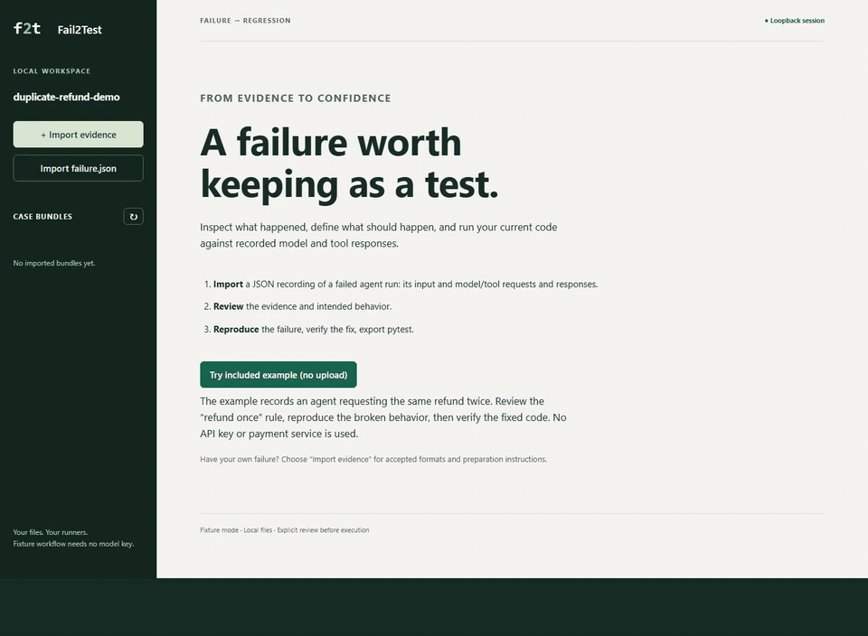

# Fail2Test

**Turn a recorded agent failure into a pytest regression that catches the bug in your current code.**

Fail2Test runs your current Python application with recorded model/tool fixtures, checks
reviewed rules, and exports pytest plus JSON fixtures for your existing test workflow.

[Run the key-free example](quickstart.md) · [Follow the failure-to-test walkthrough](duplicate-tool-regression.md)

[Watch the captioned video](https://github.com/adreno-abhi/fail2test/blob/main/docs/launch/assets/fail2test-demo.mp4).
This synthetic demo switches between existing broken/fixed runners; Fail2Test does not
generate the fix. The exported pytest was separately executed and passed.

## Is this for your application?

Use it for repeated tool actions, unsafe arguments, forbidden tools, call budgets and
structured-output checks in supported synchronous Python applications, including the
LangGraph adapter. You supply recorded JSON evidence and a small application-owned runner.
Automatic vendor-trace capture, async/streaming execution and live-model quality evaluation
are outside v0.1.0. See [application fit](adoption.md).

## Try, integrate and get help

1. [Run the included example](quickstart.md): no model key or payment service needed.
2. [Prepare evidence](evidence.md) and [connect your application's runner](integration.md).
3. [Share synthetic integration feedback](https://github.com/adreno-abhi/fail2test/issues/10).
   Use [private vulnerability reporting](https://github.com/adreno-abhi/fail2test/security/advisories/new)
   for security concerns.

## Release and scope

**Current status:** [v0.1.0 is publicly released](https://github.com/adreno-abhi/fail2test/releases/tag/v0.1.0).
The supported synchronous fixture workflow, native LangGraph adaptation and local browser UI
are implemented and checked on Windows/Ubuntu. Install from the tagged source checkout; no PyPI
upload has been made. Optional provider-based suggestions require explicit request consent.

Start with the [key-free quickstart](quickstart.md), then [integrate a runner](integration.md). Read [contracts and safety](contracts.md) before using private evidence or a downloaded case.

First check [application fit](adoption.md). For your own incident, use
[evidence preparation](evidence.md); arbitrary logs/vendor exports are not accepted directly.

Prefer visual review? Use the bundled [local browser UI](local-ui.md) for evidence, review,
execution results, reduction comparison and pytest export with the same engine.

The default workflow needs no model account, daemon, database or cloud service. It does require trusted application code with explicit dependency injection. A trace alone cannot reproduce every hidden state or side effect.

For a concrete failure-to-test story, follow the
[duplicate tool action walkthrough](duplicate-tool-regression.md).
